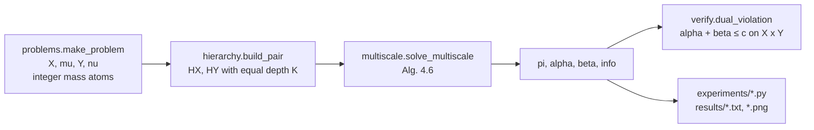
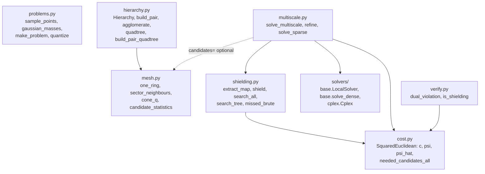
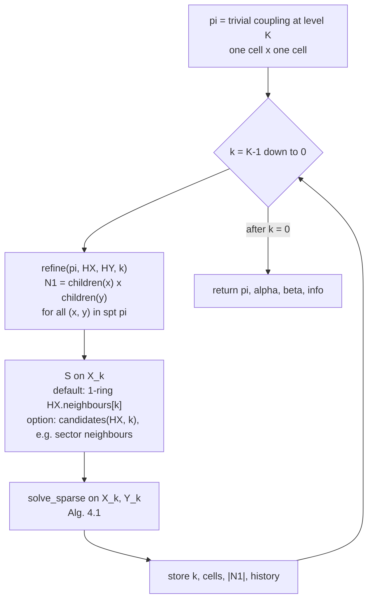
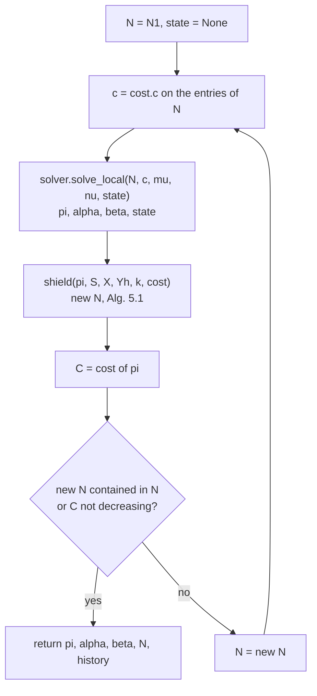
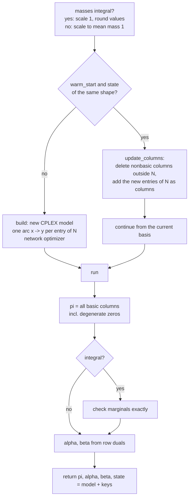
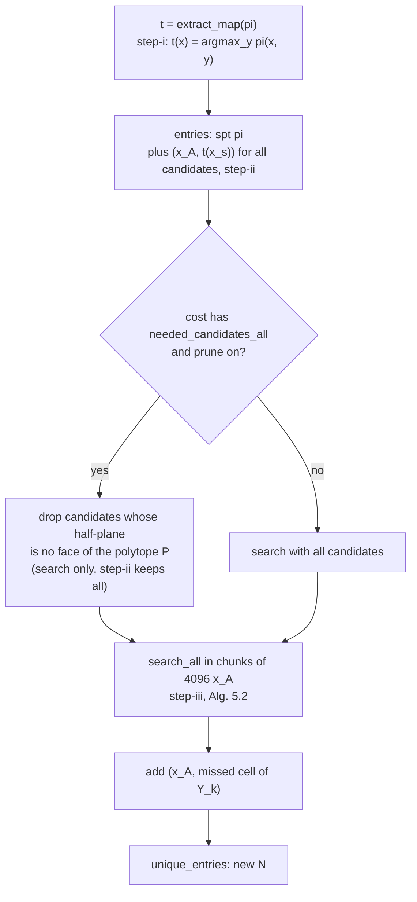
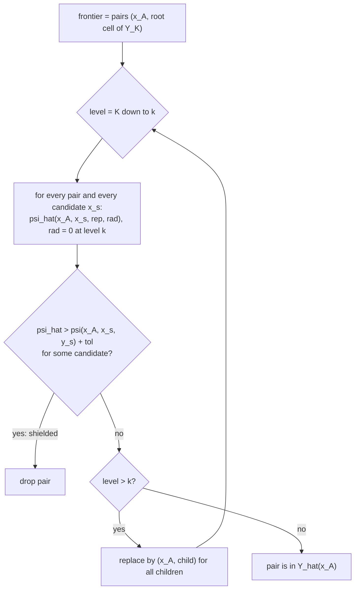
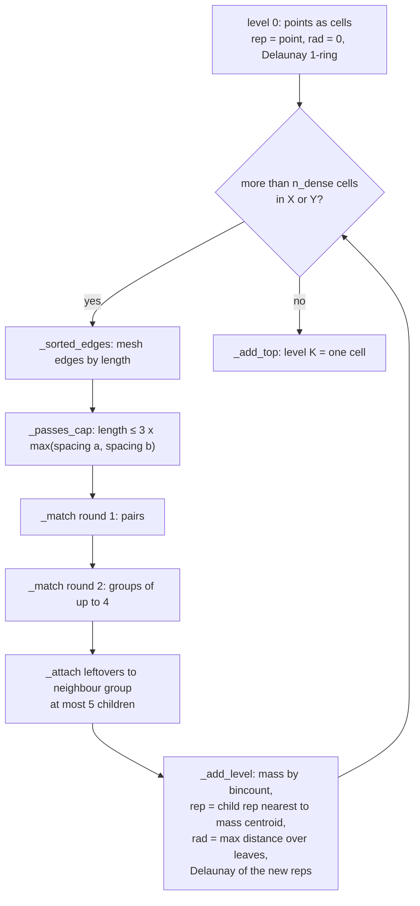

# Code flowcharts

Visual map of `src/msot` as of 2026-10-17. Algorithm numbers refer to Schmitzer 2016. GitHub renders the diagrams directly.

## 1. Pipeline

## 2. Modules and who calls whom

## 3. solve_multiscale (Alg. 4.6)

## 4. solve_sparse (Alg. 4.1)

## 5. Cplex.solve_local and the warm start

## 6. shield (Alg. 5.1)

## 7. search_all: level-synchronous Alg. 5.2

## 8. Building the mesh hierarchy (build_pair / agglomerate)

